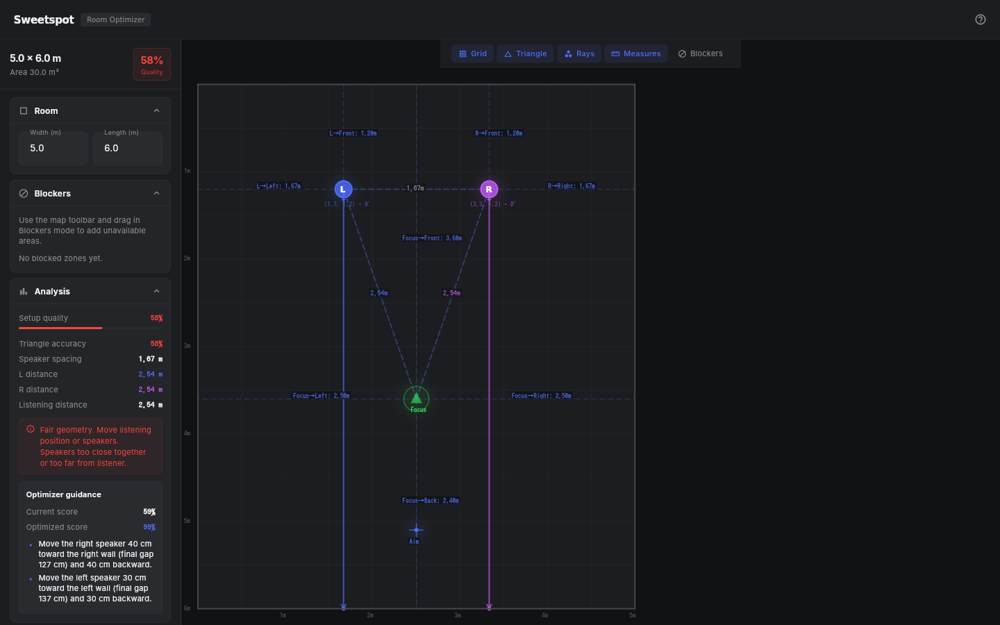

# Sweetspot



A speaker placement and room optimisation tool for people who care about how their stereo sounds. Enter the room's
size, drag the speakers and the listening position around a floor plan, and Sweetspot scores the setup: how close it
is to an equilateral triangle, the distances to each wall and to the listener, and where the first reflections land.
It then says what to move, and by how much, to get the score up. A Flutter desktop app for Linux, Windows and macOS.

## Stack

| | |
|---|---|
| Framework | Flutter (stable), Dart `>=3.3.0 <4.0.0` |
| State | Riverpod (`flutter_riverpod`) |
| Maths | `vector_math` |
| Targets | Linux, Windows and macOS desktop |
| CI | GitHub Actions: analyse on `development`, build on PRs, release on demand |

## Getting started

```bash
flutter pub get
flutter run -d linux     # or -d windows / -d macos
flutter test
```

Each desktop target needs its own toolchain: GTK 3, CMake, Ninja and Clang on Linux; the Xcode command line tools on
macOS; Visual Studio with *Desktop development with C++* on Windows. If a target isn't enabled yet, run
`flutter config --enable-<os>-desktop` once.

Ready-made builds for all three are on the [Releases](https://github.com/borysbabas/sweetspot/releases) page.

## How it scores a room

| Part | What it does |
|---|---|
| Sweet spot | Finds the listening position that forms an equilateral triangle with the two speakers |
| Aiming | Works out the toe-in so each speaker points at the listener |
| Reflections | First-order reflection points on each wall, with the image-source method: mirror the speaker through the wall and draw a line to the listener |
| Room context | Lowers the score when the speakers sit too close to the side or front wall, the listener too close to the back wall, or either too close to a blocked area |
| Optimiser | Moves the speakers and listener in 10 cm steps while the score improves, and turns the difference into plain instructions ("move the right speaker 40 cm toward the right wall") |

Blocked areas (a sofa, a cabinet, a door) are drawn on the floor plan in Blockers mode; the optimiser keeps everything
out of them.

## Releases

```bash
flutter build linux --release     # build/linux/x64/release/bundle
flutter build windows --release   # build/windows/x64/runner/Release
flutter build macos --release     # build/macos/Build/Products/Release
```

- A push to `development` runs `ci-development.yml`: dependencies and `flutter analyze`.
- A pull request from `development` to `main` runs `build-desktop.yml`, a build check only.
- `release-desktop.yml` is started by hand (**Run workflow** on *Release Desktop (Linux, Windows, macOS)*) with a
  `release_version` such as `1.2.3`, and publishes `sweetspot-linux.tar.gz`, `sweetspot-windows.zip` and
  `sweetspot-macos.zip` to a GitHub Release.

## Project structure

| Path | |
|---|---|
| `lib/main.dart`, `lib/app.dart` | Entry point and app shell |
| `lib/features/room_design/` | The room screen: floor-plan canvas and painter, setup panel, room state provider and models |
| `lib/features/acoustic/` | Sweet spot, aiming, reflections, room context and the optimiser, with their result models |
| `lib/features/splash/` | Splash screen |
| `lib/core/` | Theme and shared widgets |
| `test/` | Tests for the acoustic services and the room design |
| `linux/`, `macos/`, `windows/` | Desktop runners |
